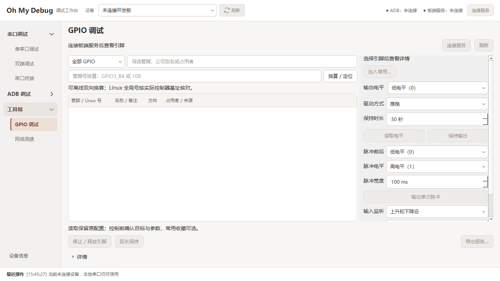
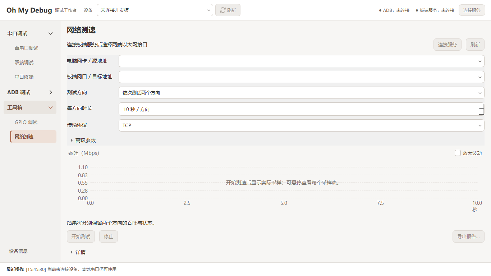
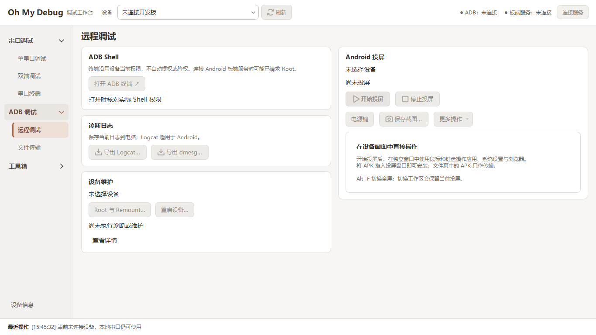

# ADR-0009：统一 GPIO 交互、数字输入与维护入口方案

[当前状态](../STATUS.md) · [产品定位](../PRODUCT.md) · [界面规范](../UI_DESIGN.md) · [工具箱契约](../features/TOOLBOX.md) · [维护契约](../features/DEVICE_MAINTENANCE.md)

- 日期：2026-11-05。
- 状态：**已实施（0.18.1）**。以下保留基于 0.18.0 的审查与设计依据；当前行为以功能契约为准，验证与交付范围见 STATUS。
- 产品仍是通用调试工作台。设备已提供的 GPIO 接口是一种便捷访问能力，适配来源不应变成用户必须理解的产品分类。
- 网络参数区统一对齐地址、方向与时长；本页记录设计原因，验证结果见 STATUS。

## 1. 本轮审查范围与证据

本轮从当前 0.18.0 程序重新捕获三个界面，均为 1366×768、100% DPR、独立设置目录的离线状态。
截图保存后已逐张检查，以下图片为本次捕获的原图，不使用前轮缓存图片作为本轮审查证据。
审查聚焦入口、文字、控件形态和操作效果是否清楚；未点击真实维护动作，也未验证键盘、读屏或 Loader 切换。

| 步骤 | 用户任务 | 当前判断 |
| --- | --- | --- |
| 1. GPIO 入口 | 找到一个引脚并读取或控制 | 编号换算、任务结果布局可保留；接口来源分类与“公司别名”需要调整 |
| 2. 网络参数 | 快速设置每方向测试时长 | 标签清楚；数字框被拉满整行，增减箭头不可辨识，需要修正 |
| 3. 设备维护 | 重启或进入升级模式 | 维护区位置清楚；按钮命名可简化，Loader 入口需补齐支持判定与发现性 |

### 步骤 1：GPIO 入口——调整对象与操作模型

截图可见来源下拉和“筛选管脚、公司别名或占用者”。源码中的下拉项为“全部 / 通用 GPIO / 板载 GPIO”。
这些词把底层适配方式暴露成产品分类，同一物理管脚却可能同时具备多种访问途径，增加了不必要的选择。
“公司别名”还把一般的资源名称表达成特定组织的功能。

建议统一为一份引脚列表和一套操作区：

- 去掉主界面的通用/板载来源切换，名称和占用者按实际数据展示，搜索提示改为“搜索引脚、名称或占用者”。
- 物理管脚、Linux 编号、设备提供的名称和用户备注关联同一对象；名称搜索和编号换算均定位到同一行。
- 后台依据已经验证的接口与能力选择访问途径，用户不需要先选接口。存在多个不确定映射时明确提示，不靠试写探测。
- 主界面区分方向、读回、占用与可用操作；驱动、路径和适配方式收入详情，不再以“公司/板载模式”组织流程。
- 收藏和备注保持可选；已有原生引脚和命名节点的备注要关联迁移，不能因访问途径变化而消失或被静默覆盖。

统一入口后仍要清楚表达操作效果：

| 用户操作 | 呈现规则 |
| --- | --- |
| 读取 | 一个明确入口，显示读回和方向；无法读取时显示原因 |
| 输出 | 按能力提供“保持输出”或“设置输出”，清楚说明时长/释放，或设置持续生效；不伪装成相同的结束行为 |
| 脉冲 / 监听 | 仅在接口确认支持时提供，不因统一列表就对所有引脚开放 |
| 占用状态 | 保留内核实际占用者；可通过已有接口操作不等于该行空闲，也不等于可以解除占用 |

现有适配继续作为后台扩展。对特定驱动命名、命令和用途的限制属于适配策略，不应被包装成所有 GPIO 的通用规则。
README、产品说明、帮助和界面同时改用“设备提供的控制接口”等中性表述；历史验证记录中的真实来源信息不删改。
本方案不新增任意 sysfs 路径编辑器、Shell 写入、解绑或临时接管。

### 步骤 2：网络时长——恢复数字输入的形态

截图中的时长框与网口地址框同宽，右侧只有难以辨认的线条，不能清楚传达数字增减操作。
源码使用 QSpinBox，但没有为时长限制合适宽度；共用样式也没有明确处理数字框的增减图形。
这是尺寸和可操作性问题，不能只用“参数能输入”作为验收依据。

建议：

- 保留“每方向时长”标签，使用约 120 逻辑像素的紧凑数字框，内容为“10 秒”，单位不再重复“/方向”。
- 右侧明确显示上下箭头，保留直接输入、上下键和标准焦点行为；网口地址继续使用可展开的长框。
- 首轮不添加新的预设按钮或扩大时长范围，保持现有 1–60 秒与每方向语义。
- 同步修正共用数字框箭头，避免保持时长、脉冲宽度、端口等控件出现同一问题；控件宽度按具体数据选择，不统一铺满整行。

可见的可访问性风险是增减目标缺乏明确图形。下一轮需要实际检查点击、键盘、边界值、焦点、禁用态及高 DPI，
并为数字框提供清楚的可访问名称；本轮截图不能证明读屏或键盘完全可用。

### 步骤 3：设备维护——简洁动作名与明确的 Loader 入口

当前按钮工厂统一追加省略号。省略号通常提示后续还需输入或确认，这是现有文字选择的依据，
并非所有带省略号的按钮都存在功能缺陷。为使本产品动作更直接，建议统一采用：

- 维护动作写为“Root 与 Remount”“重启设备”“进入 Loader”，去掉统一追加的省略号，保留一次固定设备的确认。
- “导出 Logcat…”等需要选择文件的动作保留省略号。省略号不承担风险确认或支持性判断。
- 普通重启用于日常验证，进入 Loader 用于烧录准备；两个动作独立保留，在维护区相邻展示。
- Loader 入口不因支持信息缺失而完全消失；无设备、识别中、未确认支持或任务冲突分别显示不可用原因。

现有后端已包含固定 `reboot loader` 动作、冲突检查与等待逻辑。
但默认工厂传入空的已确认序列号集合，loaderSupported 永远为假，因此实际入口一直隐藏。
后续应改为平台/BSP 能力依据，不能依赖组织私有的设备序列号名单，也不能仅凭名称中含 rk 就认定支持。

A11 源码只读核对结果为：RK3568 设备树存在 mode-loader；U-Boot 存在 BOOT_MODE_LOADER 到 Rockusb 的处理分支。
这支持继续适配的可行性，不证明当前每台运行固件都具备相同配置，或已经完成实机切换。
完整源码核对副本保存在本地忽略目录 `build/ui-discussion-20261105/`。

一键入口的范围是完成受控请求，不扩展为烧录工具：

1. 固定当前设备，检查冲突和支持依据，显示一次动作确认。
2. 发送固定 Loader 请求，不自动追加提权、刷写或其他重启模式。
3. 结果区分“请求已发出”“已退出 ADB”“已确认 Loader”；只有 USB 模式依据充分时才显示最后一种。
4. 初期不能自动确认 USB 模式时，明确提示到现有烧录工具确认，不把 ADB 离线直接显示成进入 Loader 成功。

## 2. 实施与验收建议

下一轮范围为统一 GPIO 对象/操作呈现、修正数字输入、完善维护动作命名和 Loader 入口。
保持既有界面风格、引脚计算、网络曲线、任务归属和确认规则，不重做整套工作台。

- 统一 GPIO 模型与可用操作先在无 Qt 层组织；UI 不直接按公司/板载来源分支。适配执行保持固定参数和身份核验。
- 维护支持判定与执行放后台，沿用固定设备、单任务与同设备互斥，不要求用户先连接板端 Agent。
- 验收：不选择访问模式即可查找和操作同一引脚；无私有化产品文案；收藏/备注保留；不同输出生命周期有明确说明。
- 验收：数字框不拉伸，增减箭头可辨识且可用，手输/键盘/边界和 100%/125%/150% DPI 均检查。
- 验收：Loader 的无设备/识别中/不支持/冲突/确认取消/请求失败/结果待确认均可理解；该次验证未执行真实重启。
- 真实进入 Loader 和 USB 模式确认需单独安排有条件恢复设备的实机验证，不用软件模拟或源码阅读代替。

## 3. 参考

- [Windows 命令按钮说明](https://learn.microsoft.com/en-us/windows/win32/uxguide/ctrl-command-buttons)：省略号约定的参考，属于旧版 Win32 指南，不作为本产品必须保留省略号的强制规则。
- [Rockchip USB 设备扫描实现](https://github.com/rockchip-linux/rkdeveloptool/blob/master/RKScan.cpp)：USB 模式判定需依据设备信息，与 ADB 在线状态不同。
- 实现依据：[GPIO 与时长控件](../../src/ui/pages/toolbox_pages.cpp)、[共用样式](../../src/ui/theme.cpp)、[维护面板](../../src/ui/widgets/device_maintenance_panel.cpp)、[维护后端](../../src/adapters/device/adb_device_maintenance.cpp)。

## 4. 实施时补充的网络布局取舍

用户在查看缩短后的时长框时指出：只有该字段未右对齐，与整行控件的右边缘不一致。
因此不只缩短输入框：网口地址各占一行，方向、协议和每方向时长放在同一行，标签位于各自控件上方；
时长位于右端，右边缘与地址框对齐。高级数字项为紧凑分组，Tab 顺序跟随视觉顺序。
曲线、流量路径、范围与双向时长语义保持原有契约。截图、回归结果与剩余实机项统一记在 STATUS 指向的本轮验证记录。
