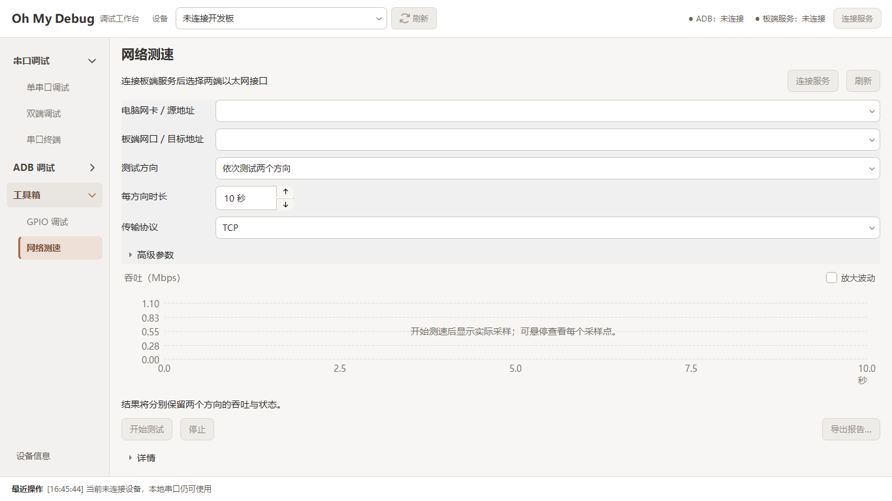
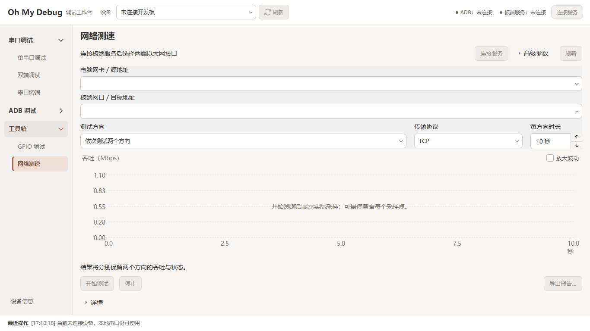
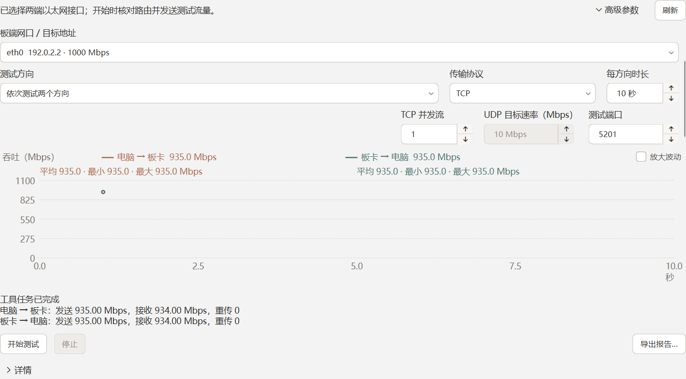

# 0.18.1 统一 GPIO、网络参数与维护入口验收

[当前状态](../STATUS.md) · [设计依据](../decisions/0009-unified-gpio-controls-and-maintenance-plan.md)

日期：2026-11-05。证据位于本地忽略目录 `build/ui-refinement-0.18.1/`。
本页是本轮验证记录，当前交付状态只维护在 STATUS。

## 范围与检查

桌面沿用 Agent 0.3.12 与协议 1，未改板端代码、驱动 ABI 或固件。
建立本轮文件摘要与差异副本后修改，保留前序未提交改动；原 Agent、依赖和交叉构建文件与本轮起始摘要一致。

- Release / Debug 构建通过。实际使用 MSVC 14.44 和独立运行目录，运行文件摘要见 artifact-evidence.json。
- 无 Qt 检查 8/8 通过，日志 core-ctest.log。新增统一身份、占用和能力限制、旧双备注保留/移除、元数据不直接授予操作；维护覆盖 Loader 完整证据、错误模式值、型号不足、超限/不完整、跨设备 A→B→A 旧结果和取消。
- 维护后端模拟检查覆盖请求前再次核验、权限失败不发送、固定 Loader 命令和 ADB 离线仅为部分结果；UI 覆盖无设备/识别中/未知/不支持/冲突、默认取消和识别期间关闭。
- 原生 UI 整套 15/15 通过，日志 ui-ctest.log。最后只调整网络高级入口位置后，用最终产品对象重建 toolbox-smoke 并补跑通过，见 toolbox-final-ctest.log。
- 数字框鼠标增减、手输、上下键、1/60 边界、禁用态、参数右边缘及 Tab 顺序通过。100%/125%/150% 有实际截图和尺寸/DPR 元数据，见 dpi-results.json、dpi-final.log 与 ui-evidence/remote-1366.json。
- 1366×768、1920×1080 与最小 1120×720 快照已检查；请求 1100×720 时由产品既有最小尺寸约束为 1120×720，没有误记为支持更小窗口。
- 共同样式、核心分层、VS 导航、Git 空白及文档入口/相对链接检查通过；static-check.log 保留结果。

## 网络参数区检查

1. **网络对齐修正前：需调整**。同一轮重新捕获的 1366×768 页面中，地址/方向/协议占满行，短时长框停在左侧，破坏右边缘。

   

2. **基本参数修正后：通过**。地址保留整行，方向/协议/时长分组同一行，时长位于右侧；上下箭头和单位可辨识。右边缘与键盘顺序由原生事件检查。

   

3. **展开高级参数：通过**。高 DPI 矮窗口检查发现旧位置会裁掉部分高级入口，故将入口固定到顶部工具栏；最终三档 DPI 下保持完整。高级数字项分组，参数区可滚动，开始/停止与曲线仍在窗口内。下图为实际 Qt 页面夹具，使用模拟地址/吞吐；已滚动到高级项，顶部地址可滚动返回，不是性能实测或图片裁剪。

   

箭头、单位和控件标签可从截图检查；键盘、范围和禁用态通过原生事件检查。没有据此宣称完整读屏或可访问性合规。

## 实机只读

两台板卡分别使用独立临时目录、进程和端口；日常服务前后身份保持，结束仅停止属于本轮的临时进程并移除其转发。

- MTB-720：11 个端点逐个读取成功；统一 UI 无来源选择即可定位和读取，未发送写入。
- RTD-XL01：otg_drv_vbus 读取成功，GPIO2_A0 / Linux 64，用途只读。
- `live-evidence/<serial>/readonly-result.json`、读取报告/PNG、before.txt/after.txt 与 live-cleanup.json 保存了本轮证据。
- 所有已适配节点值及内核占用者/方向前后一致；MTB heartbeat 的无关 LED 电平变化单独保留。
- 两板用真实桌面后端读取 Loader 证据并判定请求接口可识别，见 loader-rk3568.txt / loader-rk3562.txt。没有请求重启、切换 Loader 或确认实际 USB 模式。

首次启动 UI 只读夹具时测试依赖搜索目录不完整，进程未启动；临时进程与转发已清理。补齐测试运行环境后两板检查通过，未改产品运行依赖或设备状态。

## 未执行

- GPIO 真实输出、脉冲、物理监听及电压/负载：未验证。
- 网络实际测速流量、物理断线、Root/Remount、普通重启：本轮未验证。
- Loader 实际切换、USB 模式确认与恢复：未验证。
- 新一轮 Android/Linux 交叉构建、Linux sysfs 夹具：未执行；本轮不改板端，前轮证据不标为本轮通过。
- 长时压力、干净 Windows 安装、最终 ZIP：未验证。

本记录的验证阶段未执行暂存、提交、推送或发布，本地 ZIP 未更新。后续源码归档与交付状态以 STATUS 为准。

## ZIP 便携包补验（2026-11-05）

根据用户“测试人员解压就用”的要求，改为随包部署 MSVC x64 CRT DLL，不再要求先运行运行库安装器。
保留 Qt 和插件、ADB、scrcpy、iperf3、Agent、更新说明与工具箱帮助；不复制 SDK、PDB、测试程序或个人设置。

- 本地试用载荷 265 项，清单大小/SHA-256 与实际解压文件逐项一致，ZIP 的 SHA-256 单独提供。
- 40 个 Windows PE 的普通和延迟导入检查未发现缺失依赖；ADB 为上游 32 位程序，按 x86/WoW64 检查，不误当成 x64。
- 将 PATH 缩减到 Windows 系统目录、移除 Qt/QML 变量，在非程序工作目录启动三页离线快照通过；实际 Qt、qwindows 和 MSVC DLL 均从解压包加载。
- 同一隔离环境中运行 adb version、scrcpy --version、iperf3 --version 均通过；没有连接设备、输出 GPIO 或发送测试流量。
- 包内用户帮助的相对链接通过；上游许可/作者文件保持原样，不改写其中指向完整上游源码的链接。
- 本机无 Windows Sandbox，未执行全新 Windows 环境验收；Windows 仍需识别实际硬件驱动。

证据在 `build/zip-trial-0.18.1/`，最终包位置与交付状态只维护在 STATUS。
